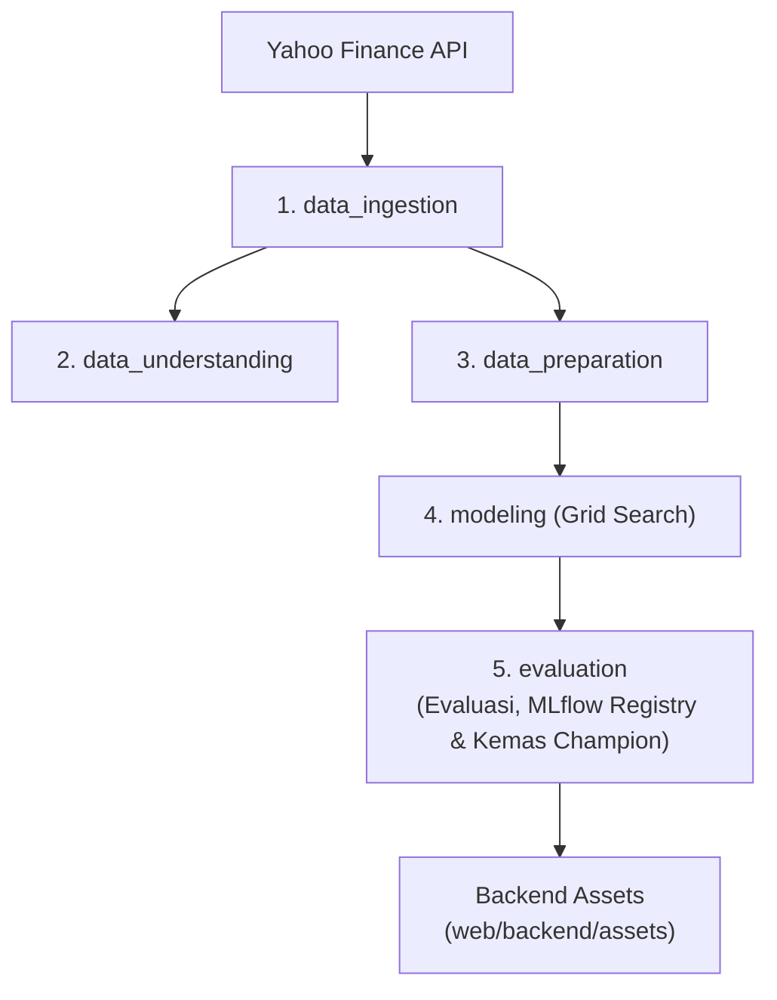

# MLOps Stock Forecasting

Pipeline MLOps end-to-end untuk peramalan harga saham temporal perbankan berbasis Deep Learning (LSTM dan GRU). Proyek ini mencakup akuisisi data otomatis, orkestrasi pipeline DVC, pelacakan eksperimen dan model registry MLflow (DagsHub), validasi promosi model *champion-challenger*, backend inferensi performa tinggi berbasis FastAPI dengan MongoDB Time Series, load testing CCU 50-1000 via Locust, serta dashboard analitik interaktif React 19.

---

## Tech Stack

| Lapisan | Komponen | Deskripsi |
| :--- | :--- | :--- |
| **Machine Learning** | TensorFlow / Keras 3.x, Scikit-Learn | Arsitektur LSTM & GRU, normalisasi MinMaxScaler, evaluasi MSE, RMSE, MAPE |
| **Pipeline & MLOps** | DVC, MLflow, DagsHub | DAG pipeline deklaratif, remote storage S3 DVC, experiment tracking, model registry |
| **Backend API** | FastAPI, Uvicorn, Gunicorn | REST API asynchronous, Pydantic v2 validation, caching in-memory |
| **Database** | MongoDB Time Series, Beanie ODM | Penyimpanan data deret waktu native dengan composite index |
| **Load Testing** | Locust | Pengujian beban bertahap (CCU 50-1000) untuk menguji throughput dan latensi |
| **Frontend** | React 19, Vite, TanStack Router, ECharts | Dashboard analitik interaktif, charting candlestick & forecast band |
| **DevOps & Cloud** | Docker, GitHub Actions, Azure | CI/CD pipeline, Azure Container Apps (Backend), Azure Static Web Apps (Frontend) |

---

## Arsitektur Pipeline



### Tahapan Pipeline (dvc.yaml)

1. **data_ingestion**: Mengambil data historis OHLCV dari Yahoo Finance (`yfinance`) dan menyimpannya ke `artifact/data/{ticker}.csv`.
2. **data_understanding**: Menghitung ringkasan statistik deskriptif dan menghasilkan visualisasi histori harga.
3. **data_preparation**: Membagi subset train/test secara kronologis sekuensial (80:20, tanpa kebocoran data) dan melakukan scaling dengan `MinMaxScaler`.
4. **modeling**: Melakukan grid search hyperparameter (time steps, batch size, learning rate) untuk model LSTM dan GRU dengan *Early Stopping* (`monitor="loss"`, `patience=8`).
5. **evaluation**: Mengevaluasi model pada data uji (MSE, RMSE, MAPE), membuat visualisasi inferensi, meregistrasikan model ke MLflow, dan memvalidasi ambang batas untuk mengemas aset champion ke `web/backend/assets/`.

---

## Logika Promosi Model (@challenger ke @champion)

Pengemasan dan seleksi model produksi diintegrasikan langsung pada tahap `src/evaluation.py`:

- **Kriteria Seleksi**: Model kandidat diurutkan berdasarkan **RMSE terkecil** pada data uji.
- **Validasi Ambang Batas**:
  - Model terbaik diuji terhadap ambang batas $\text{MAPE} < 10.0\%$ (Kategori Akurasi Sangat Baik menurut Lewis).
- **Penetapan Status & Aset**:
  - **Lolos Ambang Batas**: Model ber-RMSE terkecil dilabeli alias **`@champion`** di MLflow Model Registry, dan artefaknya (`.keras` dan `scaler.pkl`) dikemas ke `web/backend/assets/` untuk inferensi produksi. Model lainnya dilabeli **`@challenger`**.
  - **Tidak Lolos**: Model dilabeli **`@challenger`** dan aset produksi di backend tidak ditimpa demi menjaga stabilitas sistem.

---

## Struktur Direktori

```text
MLOps-Stock-Forecasting/
├── artifact/              # Artefak data, metrik, model, dan visualisasi
│   ├── data/              # File dataset mentah (.csv) dan siap latih (.npz)
│   ├── metrics/           # Metrik evaluasi (.json) dan hyperparameter (.csv)
│   ├── model/             # Bobot model terlatih (.keras) dan scaler (.pkl)
│   ├── plots/             # Grafik visualisasi data historis dan inferensi (.png)
│   └── report.md          # Ringkasan laporan performa pipeline
├── notebooks/             # Notebook analisis dan otomasi pelaporan
│   └── ml_report.ipynb    # Template laporan pipeline via Papermill
├── src/                   # Modul kode pipeline MLOps
│   ├── config.py          # Resolusi path dan konfigurasi terpusat
│   ├── data_ingestion.py  # Tahap 1: Akuisisi data Yahoo Finance
│   ├── data_understanding.py # Tahap 2: Ringkasan statistik & visualisasi
│   ├── data_preparation.py   # Tahap 3: Pemisahan sekuensial & normalisasi
│   ├── modeling.py        # Tahap 4: Pelatihan model & grid search
│   └── evaluation.py      # Tahap 5: Evaluasi data uji, registrasi & kemas champion
├── web/
│   ├── backend/           # Service inferensi FastAPI dan pengujian beban
│   │   ├── app/           # Routes, Controllers, Services, dan Models
│   │   ├── assets/        # Artefak model champion aktif untuk inferensi
│   │   ├── tests/         # Pengujian beban Locust (locustfile.py & runner)
│   │   └── requirements.txt # Dependensi backend
│   └── frontend/          # Web dashboard visualisasi React 19
├── dvc.yaml               # Definisi DAG orkestrasi pipeline
├── params.yaml            # Parameter konfigurasi dan ambang batas
├── pyproject.toml         # Manajemen dependensi Poetry
└── README.md              # Dokumentasi utama repositori
```

---

## Parameter Pipeline (params.yaml)

```yaml
TICKERS:
  - BBCA.JK
RANGE_DAYS: 1825
END_DATE: "auto"

TARGET_COL: "close"
RANDOM_STATE: 42
TRAIN_SIZE: 0.8
EPOCHS: 500

# Hyperparameter Grid
TIME_STEPS:
  - 20
  - 30
BATCH_SIZES:
  - 16
  - 32
LEARNING_RATES:
  - 0.001
  - 0.0001

# Ambang Batas Kelayakan Champion
THRESHOLD_MAPE: 10.0 # Maksimum MAPE < 10%
```

---

## Panduan Menjalankan

### Prasyarat
- Python 3.10 - 3.12 & Poetry
- Node.js 20+ & npm
- MongoDB lokal (`mongodb://localhost:27017`) atau MongoDB Atlas

### 1. Setup Lingkungan Pipeline
```bash
git clone https://github.com/qoriib/MLOps-Stock-Forecasting.git
cd MLOps-Stock-Forecasting
cp .env.example .env
poetry install
```

### 2. Menjalankan Pipeline DVC
```bash
# Menjalankan seluruh tahapan pipeline
poetry run dvc repro

# Menjalankan pengemasan aset champion ke backend
poetry run model_packaging
```

### 3. Menjalankan Backend API
```bash
cd web/backend
python3 -m venv .venv
source .venv/bin/activate
pip install -r requirements.txt
cp .env.example .env
uvicorn main:app --host 0.0.0.0 --port 8000 --reload
```
Dokumentasi Swagger API aktif di `http://localhost:8000/docs`.

### 4. Menjalankan Load Testing Backend (CCU 10-150)
```bash
cd web/backend
# Mode otomatis headless (output Markdown report)
python tests/run_load_test.py --host http://localhost:8000 --users 150 --spawn-rate 20 --run-time 1m

# Mode interaktif web dashboard Locust
locust -f tests/locustfile.py --host http://localhost:8000
```
Dashboard Locust interaktif dapat diakses di `http://localhost:8089`.

### 5. Menjalankan Frontend
```bash
cd web/frontend
npm install
npm run dev
```
Aplikasi dashboard dapat diakses di `http://localhost:3000`.

---

## Variabel Lingkungan (.env)

| Lingkup | Variabel | Deskripsi |
| :--- | :--- | :--- |
| **Root** | `MLFLOW_TRACKING_URI` | Endpoint URI pelacakan eksperimen MLflow DagsHub |
| | `AWS_ACCESS_KEY_ID` / `AWS_SECRET_ACCESS_KEY` | Kredensial remote storage S3 DagsHub DVC |
| **Backend** | `MONGODB_URL` | URI koneksi MongoDB (`mongodb://localhost:27017`) |
| | `MONGODB_DB_NAME` | Nama database time series (`stock_forecasting`) |
| **Frontend** | `VITE_API_URL` | URL basis host backend API (`http://localhost:8000`) |

---

## Lisensi

Proyek ini dilisensikan di bawah [MIT License](LICENSE).
